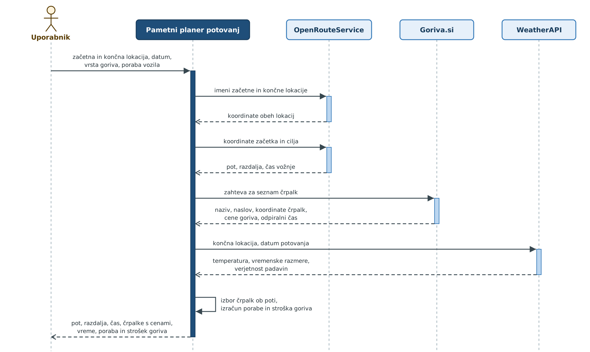

# Pametni planer potovanj

Aplikacija za načrtovanje potovanj z avtomobilom. Na enem mestu prikaže pot, razdaljo in čas vožnje, bencinske črpalke ob poti z aktualnimi cenami goriva, vremensko napoved na cilju ter oceno porabe in stroška goriva.

## Funkcionalnosti

- načrtovanje poti med začetno in končno lokacijo
- izračun razdalje in predvidenega časa vožnje
- vremenska napoved za končno lokacijo
- bencinske črpalke v bližini poti, cene goriva in odpiralni čas
- ocena porabe in stroška goriva glede na porabo vozila

## Kako deluje

Uporabnik vnese začetno in končno lokacijo, datum potovanja, vrsto goriva in povprečno porabo vozila. Aplikacija nato:

1. pretvori lokaciji v koordinate in izračuna pot,
2. pridobi bencinske črpalke in izbere tiste, ki so v bližini poti,
3. pridobi vremensko napoved za končno lokacijo,
4. izračuna porabo in strošek goriva,
5. prikaže združen načrt potovanja.

## Uporabljene storitve

| Storitev | Namen | Prejme | Vrne | Oblika |
|---|---|---|---|---|
| OpenRouteService | geokodiranje in izračun poti | imeni lokacij, nato koordinate | koordinate lokacij, pot, razdalja, čas vožnje | JSON / GeoJSON |
| Goriva.si | bencinske črpalke in cene goriva | zahteva za seznam črpalk (po straneh) | naziv, naslov, koordinate, cene goriva, odpiralni čas | JSON |
| WeatherAPI | vremenska napoved na cilju | končna lokacija, datum potovanja | temperatura, vremenske razmere, verjetnost padavin | JSON |

## Nastavitve

Aplikacija potrebuje API ključa, ki se hranita v okoljskih spremenljivkah in nista del repozitorija:

| Spremenljivka | Storitev |
|---|---|
| `ORS_API_KEY` | OpenRouteService |
| `WEATHER_API_KEY` | WeatherAPI |

## Dokumentacija

Projekt:

- [Načrt projekta](docs/nacrt_projekta.docx)
- [Diagram zaporedja](docs/diagram_zaporedja.png)

Storitve:

- [OpenRouteService API](https://openrouteservice.org/dev/#/api-docs)
- [Goriva.si API](https://goriva.si/api/v1/search/) (uradne dokumentacije ni, povezava vodi do končne točke)
- [WeatherAPI](https://www.weatherapi.com/docs/)

## Omejitve

Podatki o bencinskih črpalkah in cenah goriva so na voljo samo za Slovenijo.
